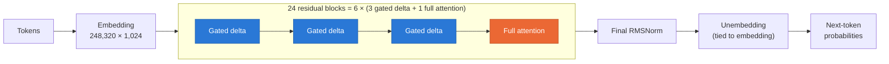
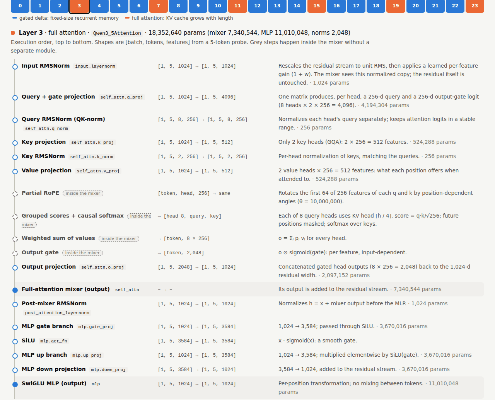
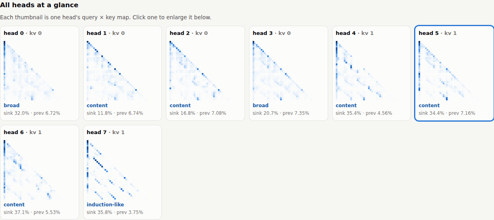
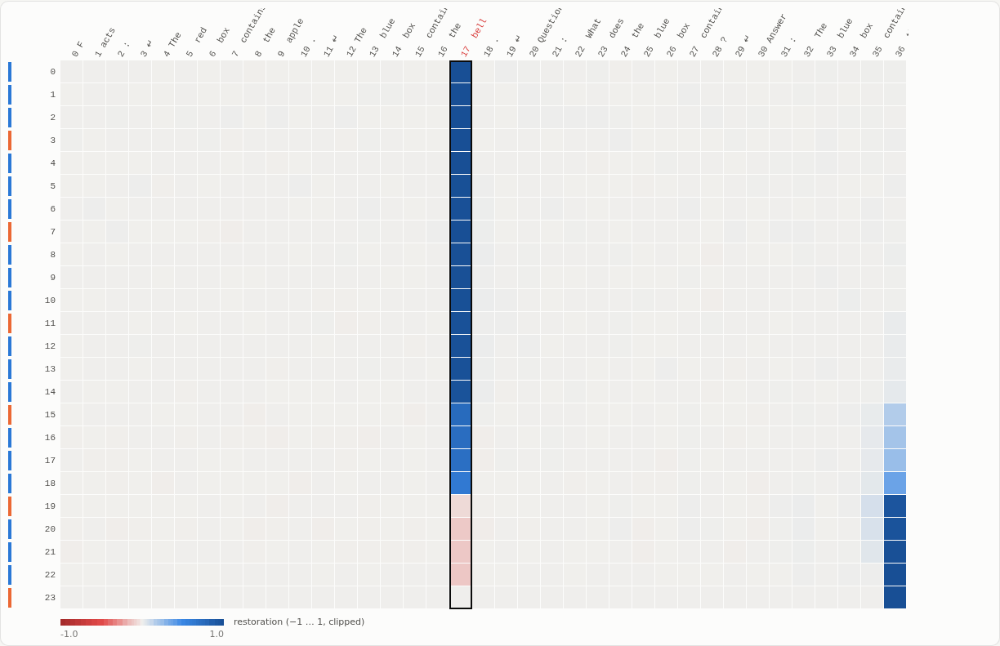
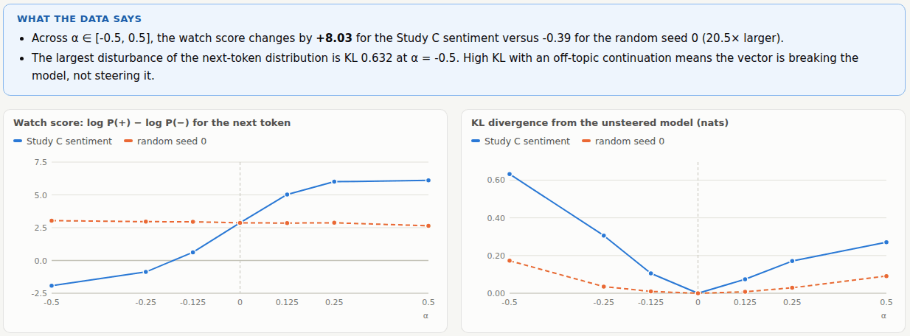

<div align="center">

# nano_inspect

**Open up a hybrid language model and watch it compute.**

A local interpretability workbench for **Qwen3.5-0.8B**, a model that mixes linear-attention (Gated DeltaNet) layers with a few full-attention layers.
It covers architecture accounting, operation-by-operation computation traces, and controlled causal interventions, plus a browser UI for self-study.

[](LICENSE)


**English** · [简体中文](README.zh.md)

[Quick start](#quick-start) · [Workbench](#the-workbench) · [Findings](#what-the-experiments-found) · [Commands](#command-line) · [Scope](#evidence-and-scope)

</div>

---

## Why this project

Most interpretability tooling assumes a plain Transformer. Qwen3.5 does not fit that assumption: **18 of its 24 layers** are Gated DeltaNet blocks. These compress the past into a fixed-size matrix memory instead of attending to every earlier token. nano_inspect asks how such a hybrid actually stores, moves and uses information, and it answers with measurements rather than diagrams alone:

- 🗺️ **Atlas:** every module, parameter and cache tensor, reconciled between the checkpoint, the loaded model and the executed text path.
- 🔬 **Microscope:** one prompt through one mixer, operation by operation, with real numbers recomputed by hand. It is checked bit-exact against the untouched model.
- 🧪 **Experiments:** retrieval behaviour, clean→corrupted activation patching and contrastive steering, each with controls.
- 🖥️ **Workbench:** a localhost UI that runs all of the above on **your own prompts**, with explanations in English or 中文.

## The model at a glance



Each block computes `h = x + Mixer(RMSNorm(x))`, then `y = h + MLP(RMSNorm(h))`.

| | Gated delta (layers 0–2, 4–6, …) | Full attention (layers 3, 7, 11, 15, 19, 23) |
| --- | --- | --- |
| **Memory of the past** | 16 heads, each a fixed 128 × 128 matrix | Keys and values for every earlier token |
| **Update rule** | Delta rule: `S ← exp(g)·S + β·k·(v − kᵀS)ᵀ` | Softmax over `q·k / √d` (GQA 8 q / 2 kv, partial RoPE) |
| **Cache cost** | Constant, about 19.8 MB in total at any length | Grows by **12,288 bytes per token** |
| **Strength** | Cheap and constant per token | Exact random access |

## Quick start

> **Requirements:** Linux, conda and an NVIDIA GPU (the default config is CUDA BF16). The model is about 1.7 GB.

```bash
git clone https://github.com/Chi-Shan0707/nano_inspect.git
cd nano_inspect

bash scripts/bootstrap.sh                                  # conda env from the pinned locks + editable install
conda run -n nano-interpretability nanoinspect download --config configs/model.yaml   # ModelScope snapshot → models/
conda run -n nano-interpretability nanoinspect serve       # open http://127.0.0.1:8765
```

`bootstrap.sh` creates the `nano-interpretability` environment from `conda-linux-64.lock` (conda-forge only) and `requirements.lock` (pip, with the CUDA 12.8 PyTorch index). It then runs `nanoinspect doctor`. After the download, inference loads only the local snapshot and needs no network.

## The workbench

`nanoinspect serve` starts a local web UI. Every view states **the question it answers** and explains the idea with formulas and a hover glossary. It runs the model on **your input**, then writes a "What the data says" summary of the actual result. Example buttons only pre-fill the editable form. The **EN / 中文** switch translates all explanations and keeps key terms (residual stream, logit lens, …) in English.

<table>
<tr>
<td width="50%" valign="top">

**1 · Architecture**: click any layer to see each step in execution order, with observed tensor shapes, parameter counts and what it does.



</td>
<td width="50%" valign="top">

**3 · Mixer maps**: all attention heads of a layer side by side. Each head is labelled by its pattern: mostly sink, previous-token, self, broad, content or induction-like.



**5 · Patching**: restore the clean activation at each (layer, position). The answer token's information sits at its own position until about layer 18, then moves to the final token.



</td>
</tr>
<tr>
<td colspan="2">

**6 · Steering**: sweep the strength α of a sentiment direction against a random direction of equal norm. One chart shows the behavioural effect (left) and the other shows how much the model is disturbed (right).



</td>
</tr>
</table>

| View | What you do and see |
| --- | --- |
| **Start here** | The model in one picture, a suggested learning path, how to read the views, glossary |
| **1 Architecture** | Config, the 3 × gated delta + 1 × full attention schedule, and a per-layer pipeline. Also parameter shares, measured cache sizes and a hybrid-vs-all-attention scaling chart. Reads `runs/inventory/` |
| **2 Layer walkthrough** | One mixer, one token, one head. Every recorded operation (formula, named-axis shape, statistics, pinned source line), the hand-recomputed worked example, and each head's direct logit effect |
| **3 Mixer maps** | **Full attention:** all heads with sink, previous-token and induction statistics. **Gated delta:** per-head retention, half-life, write strength and memory norm. Gated delta is never drawn as attention |
| **4 Logit lens** | Top-1 prediction at every (layer, position), per-cell top-k, the target's probability and rank by layer, component norms |
| **5 Patching** | Clean→corrupted patching over every (layer, position) for residual, mixer or MLP sites. A generated description of where the information moves |
| **6 Steering** | `h + α·unit·v̂` with the saved direction, a random control or a custom direction built from your prompt pairs. A single run or an α-sweep showing watch score, KL and continuations |
| **Reports** | Links to every saved `report.html` and its figures |

<details>
<summary><b>Limits and design notes</b></summary>

- Prompt limits: 256 tokens (128 for the walkthrough, 96 for patching). Patching requires clean and corrupted prompts with equal token counts.
- The server uses only the Python standard library and binds to `127.0.0.1`. It loads the model once and runs analyses one at a time. Each analysis registers scoped hooks that are removed when it returns.
- The logit lens is a probe. Attention weights and norms are not causal evidence; use patching, the steering controls or the saved studies for causal claims.
- Options: `--port`, `--host`, `--no-preload`.

</details>

## What the experiments found

All numbers come from the saved runs; [docs/findings.md](docs/findings.md) gives each one with its prediction, controls, alternative explanations and next experiment.

| Question | Result |
| --- | --- |
| **Where are the parameters?** | 853.0 M unique loaded parameters; the text path uses 752.4 M. The tied embedding alone is 254.3 M, about **34 % of the text path**. The checkpoint's 15 MTP tensors (20.5 M) are never loaded. |
| **How does the cache grow?** | Only the 6 full-attention layers grow, by exactly **12,288 B/token**. The 18 gated-delta layers stay at a constant **19.8 MB** (18.9 MB recurrent state + 0.9 MB convolution state) from 10 to 1,370 tokens. |
| **Is the instrumentation faithful?** | Bit-exact against the untouched model in all 18 same-kernel checks; all 25 BF16 and 9 FP32 parity checks pass. A 0.34-logit gap under padding was traced to BF16 chunked-vs-recurrent kernel rounding, not to an adapter bug. |
| **Can it retrieve over long contexts?** | Held-out accuracy on sentence-format key/value facts is **0.98–1.00** in every condition, up to 16 facts and 1,370 tokens. A terse list format with no filler drops to 0.70–0.86. |
| **Which layers move the answer?** | Patching on 60 pairs: final-position recovery is 0 through layer 14. It jumps at **full-attention layer 15**, whose mixer output alone recovers 0.567 of the gap. Full-attention mixers average 0.109 recovery, versus 0.010 for gated-delta mixers. |
| **Is the steering direction real?** | Over α ∈ [−0.5, 0.5] the sentiment direction moves log-odds from −3.60 to +4.46, while random directions stay within [−1.46, +0.57]. However, positive steering collapses unrelated capital-city QA (accuracy 1.00 → 0.44 at α = +0.125 → 0.00 at +0.5). |

## Command line

All commands run inside the `nano-interpretability` conda environment. Configurations merge over `configs/model.yaml`.

```bash
conda run -n nano-interpretability nanoinspect doctor                      # environment and GPU report
conda run -n nano-interpretability nanoinspect inventory --config configs/model.yaml
conda run -n nano-interpretability nanoinspect trace --config configs/trace_short.yaml
conda run -n nano-interpretability nanoinspect experiment --config configs/retrieval_patch.yaml
conda run -n nano-interpretability nanoinspect report --run runs/experiment
conda run -n nano-interpretability nanoinspect serve
conda run -n nano-interpretability python -m pytest
```

| Command | Output | What it produces |
| --- | --- | --- |
| `inventory` | `runs/inventory/` | Checkpoint, loaded and text-path parameter accounting; layer schedule; block diagrams; measured cache sizes |
| `trace` | `runs/trace/` | One prompt through a gated-delta and a full-attention layer: each operation with shapes, axes, statistics, value slices and pinned source lines. Also worked examples, residual and logit effects, and parity checks with dtype-specific tolerances. **Fails if any parity check fails.** |
| `experiment` | `runs/experiment/` | Study A (retrieval vs distance and distractors), Study B (patching with controls), Study C (steering vs random directions, prefill-only vs decode-time, quality cost) |
| `report` | `report.html` | Rebuilds a run's HTML report; `--compare` shows shared scalar fields of two runs |
| `baseline` | `runs/baseline/` | Deterministic generation; `--offline-check` repeats it with the network blocked |
| `serve` | (interactive) | The workbench above |
| `scripts/walkthrough.py` | stdout | The trace printed as a step-by-step text walkthrough of both mixer types |

`trace` accepts `--prompt`, `--layer`, `--token`, `--head` (an integer or `auto`) and `--site`. Open a generated `report.html` directly in a browser. Reports link to the JSON and tensor files in their run directory, so keep those together when sharing.

<details>
<summary><b>Full reproduction sequence</b></summary>

```bash
conda run -n nano-interpretability nanoinspect doctor
conda run -n nano-interpretability nanoinspect download --config configs/model.yaml
conda run -n nano-interpretability nanoinspect baseline --config configs/model.yaml --output runs/baseline
conda run -n nano-interpretability nanoinspect baseline --config configs/model.yaml --output runs/baseline-offline --offline-check
conda run -n nano-interpretability nanoinspect inventory --config configs/model.yaml
conda run -n nano-interpretability nanoinspect trace --config configs/trace_short.yaml
conda run -n nano-interpretability nanoinspect experiment --config configs/retrieval_patch.yaml
conda run -n nano-interpretability nanoinspect report --run runs/inventory
conda run -n nano-interpretability nanoinspect report --run runs/trace
conda run -n nano-interpretability nanoinspect report --run runs/experiment
conda run -n nano-interpretability nanoinspect report --run runs/baseline-offline --compare runs/baseline
conda run -n nano-interpretability python scripts/walkthrough.py
```

A from-scratch rebuild in a temporary environment reproduced the offline baseline bit-identically. `requirements.lock` does not pin setuptools, so that rebuild received setuptools 81.0.0 rather than 78.1.0. The default configuration targets CUDA BF16 with eager attention; each run records its hardware and dtype.

</details>

## Repository layout

```text
nano_inspect/
├── src/nanoinspect/
│   ├── runtime.py        offline model loading, provenance, determinism
│   ├── inventory.py      parameter / module / cache atlas (M1)
│   ├── trace.py          computation microscope and parity checks (M2)
│   ├── adapters/         version-pinned Qwen3.5 instrumentation (from Transformers, Apache-2.0)
│   ├── sites.py  capture.py  interventions.py    scoped capture, patching, steering (M3)
│   ├── experiments/      Studies A–C: retrieval, patching, steering
│   ├── workbench.py      analyses behind the web UI
│   ├── server.py  web/   stdlib HTTP server and the browser front end
│   └── cli.py            the `nanoinspect` command
├── configs/              model, trace and experiment settings
├── docs/                 architecture notes (EN / 中文) and experimental findings
├── tests/                38 tests (tiny random models + integration on the real checkpoint)
└── scripts/              bootstrap.sh, walkthrough.py
```

`models/` (the downloaded snapshot) and `runs/` (all generated evidence) are created locally and are not tracked by git. Links into `runs/` in the docs resolve after you run the commands above.

## Evidence and scope

- The full multimodal model is inventoried; execution and interventions use the text path. Loaded unique storage, logical parameter references, checkpoint tensors and executed text-path parameters are reported as separate quantities.
- Full attention and gated-delta recurrence have different state semantics. Recurrent states are shown as matrices and trajectories, never as softmax attention maps.
- Capture records run, layer, token, position, phase, site, shape, dtype and revision metadata, and it enforces a byte budget estimated before the forward pass. Interventions use scoped hooks that are removed on exit, even after exceptions.
- A steering effect demonstrates controllability under the tested intervention; it does not establish a unique semantic representation.

See [docs/architecture.md](docs/architecture.md) for how to read the atlas and [docs/findings.md](docs/findings.md) for the recorded experimental findings.

## License

Released under the [Apache License 2.0](LICENSE). `src/nanoinspect/adapters/qwen35.py` is adapted from [Hugging Face Transformers](https://github.com/huggingface/transformers) (Apache-2.0); see [NOTICE](NOTICE). The Qwen3.5 weights are not distributed here; they are downloaded separately and are subject to their own license.
