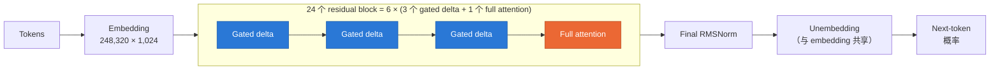
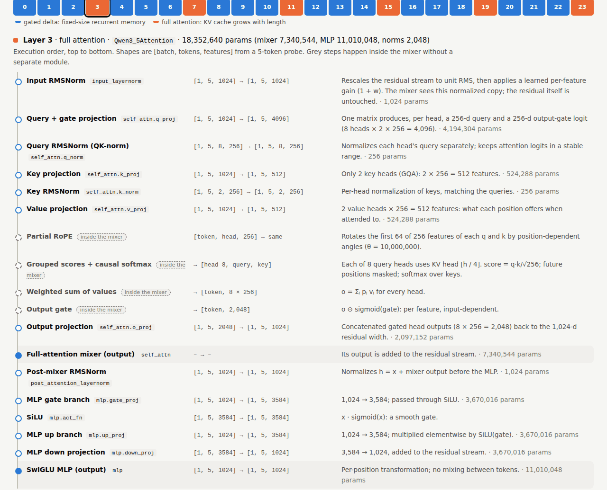
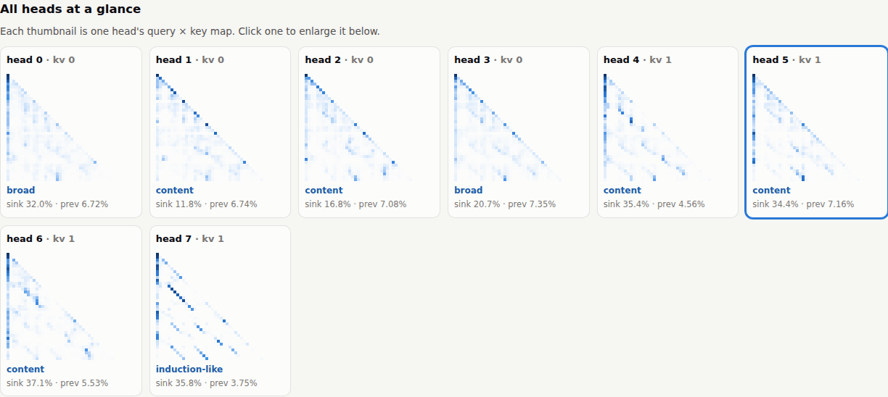
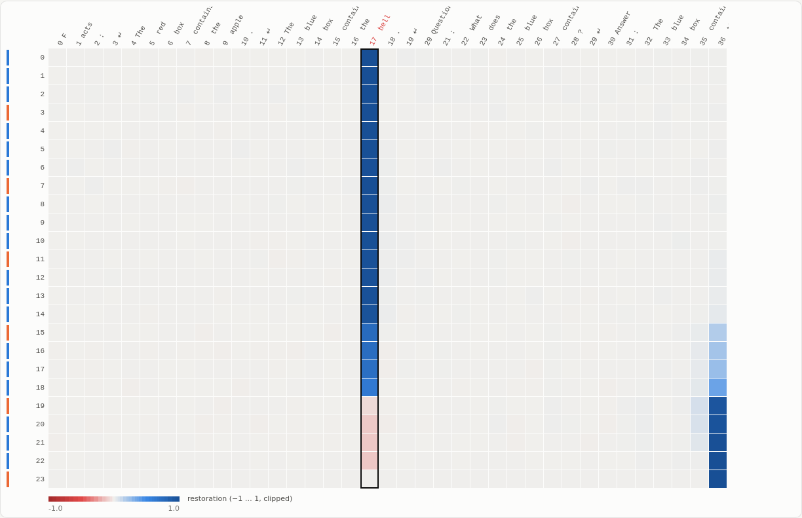
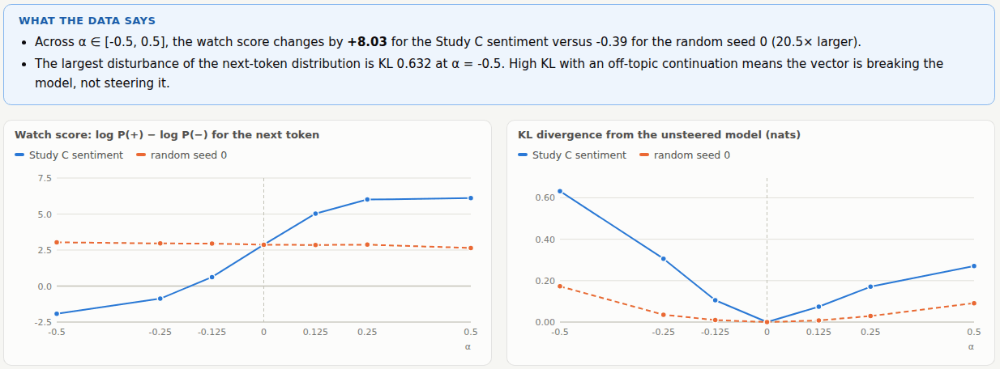

<div align="center">

# nano_inspect

**打开一个混合架构语言模型，亲眼看它如何计算。**

面向 **Qwen3.5-0.8B** 的本地可解释性工作台。该模型由 linear attention（Gated DeltaNet）层与少量 full attention 层混合而成。
本项目包含架构清点、逐操作的计算追踪、带对照的因果干预实验，以及一个用于自学的浏览器界面。

[](LICENSE)


[English](README.md) · **简体中文**

[快速开始](#快速开始) · [工作台](#工作台) · [实验发现](#实验发现了什么) · [命令行](#命令行) · [证据与范围](#证据与范围)

</div>

---

## 为什么做这个项目

大多数可解释性工具都默认模型是标准 Transformer，而 Qwen3.5 并不符合这个前提：它的 **24 层中有 18 层**是 Gated DeltaNet block。这些层不会 attend 到每一个之前的 token，而是把过去压缩进一个固定大小的矩阵记忆。nano_inspect 研究的问题是：这样的混合模型究竟如何存储、搬运和使用信息？回答依靠的是测量，而不仅仅是示意图：

- 🗺️ **图谱（Atlas）**：清点每个模块、参数和 cache 张量，并在 checkpoint、加载后的模型和实际执行的文本路径之间逐项核对。
- 🔬 **显微镜（Microscope）**：一个 prompt 穿过一个 mixer，逐个操作展示，用真实数值手工复算，并与未插桩的模型做逐位（bit-exact）比对。
- 🧪 **实验**：retrieval 行为、clean→corrupted activation patching、对比式 steering，每一项都带对照组。
- 🖥️ **工作台**：本地网页界面，在**你自己的 prompt** 上运行以上所有分析，讲解支持 English / 中文。

## 模型一览



每个 block 先计算 `h = x + Mixer(RMSNorm(x))`，再计算 `y = h + MLP(RMSNorm(h))`。

| | Gated delta（第 0–2、4–6… 层） | Full attention（第 3、7、11、15、19、23 层） |
| --- | --- | --- |
| **对过去的记忆** | 16 个 head，每个是固定的 128 × 128 矩阵 | 保存之前每个 token 的 key 和 value |
| **更新规则** | Delta rule：`S ← exp(g)·S + β·k·(v − kᵀS)ᵀ` | 对 `q·k / √d` 做 softmax（GQA 8 q / 2 kv，partial RoPE） |
| **Cache 开销** | 恒定，任意长度下总计约 19.8 MB | 每个 token 增长 **12,288 字节** |
| **优势** | 每个 token 的计算量低且恒定 | 可精确随机访问 |

## 快速开始

> **环境要求**：Linux、conda 和 NVIDIA GPU（默认配置为 CUDA BF16）。模型约 1.7 GB。

```bash
git clone https://github.com/Chi-Shan0707/nano_inspect.git
cd nano_inspect

bash scripts/bootstrap.sh                                  # 按锁定文件创建 conda 环境，并以 editable 模式安装
conda run -n nano-interpretability nanoinspect download --config configs/model.yaml   # 下载 ModelScope 快照到 models/
conda run -n nano-interpretability nanoinspect serve       # 打开 http://127.0.0.1:8765
```

`bootstrap.sh` 依据 `conda-linux-64.lock`（仅 conda-forge）和 `requirements.lock`（pip，使用 CUDA 12.8 的 PyTorch 源）创建 `nano-interpretability` 环境，然后运行 `nanoinspect doctor`。下载完成后，推理只加载本地快照，不需要联网。

## 工作台

`nanoinspect serve` 会启动一个本地网页界面。每个视图都会说明**它要回答的问题**，并用公式和悬停词汇表讲解相关概念。它在**你的输入**上运行模型，再根据实际结果生成一段「数据告诉我们什么」的总结。示例按钮只负责填充表单，所有字段都可以自由修改。点击 **EN / 中文** 可切换全部讲解文字，关键术语（residual stream、logit lens 等）保留英文。

<table>
<tr>
<td width="50%" valign="top">

**1 · 架构**：点击任意一层，按执行顺序查看每一步，附带实测的张量形状、参数量及其作用。



</td>
<td width="50%" valign="top">

**3 · Mixer 图谱**：把一层的所有 attention head 并排展示，并按模式给每个 head 标注：mostly sink、previous-token、self、broad、content 或 induction-like。



**5 · Patching**：在每个（层，位置）上恢复 clean activation。答案 token 的信息一直停留在它自己的位置上，直到约第 18 层，之后才转移到最后一个 token。



</td>
</tr>
<tr>
<td colspan="2">

**6 · Steering**：在 sentiment 方向和同等范数的随机方向上扫描强度 α。左图显示对行为的影响，右图显示对模型的扰动程度。



</td>
</tr>
</table>

（截图为英文界面，切换到中文后讲解文字会随之翻译。）

| 视图 | 你能做什么、看到什么 |
| --- | --- |
| **从这里开始** | 一张图看懂模型、推荐学习路径、如何阅读各视图、词汇表 |
| **1 架构** | 配置、3 × gated delta + 1 × full attention 的层排布，以及逐层流水线。另有参数占比、实测 cache 大小，以及混合架构与纯 attention 的扩展对比图。读取 `runs/inventory/` |
| **2 逐层拆解** | 一个 mixer、一个 token、一个 head。展示每个被记录的操作（公式、带命名轴的形状、统计量、固定版本的源码行）、手工复算的示例，以及每个 head 的直接 logit 效应 |
| **3 Mixer 图谱** | **Full attention**：所有 head 及其 sink、previous-token、induction 统计。**Gated delta**：逐 head 的保留率、半衰期、写入强度和记忆范数。gated delta 从不被画成 attention |
| **4 Logit lens** | 每个（层，位置）的 top-1 预测、单元格 top-k、目标 token 的概率和排名随层的变化、各组件范数 |
| **5 Patching** | 在每个（层，位置）上对 residual、mixer 或 MLP 位点做 clean→corrupted patching，并自动描述信息在哪里转移 |
| **6 Steering** | `h + α·unit·v̂`，方向可选已保存的方向、随机对照，或由你的 prompt 对构建的自定义方向。支持单次运行或 α 扫描，展示 watch score、KL 和续写结果 |
| **报告** | 链接到每个已保存的 `report.html` 及其图表 |

<details>
<summary><b>限制与设计说明</b></summary>

- Prompt 上限：256 个 token（逐层拆解为 128，patching 为 96）。Patching 要求 clean 与 corrupted prompt 的 token 数相同。
- 服务器只用 Python 标准库，并绑定在 `127.0.0.1`。模型只加载一次，分析逐个运行。每次分析注册的 hook 都有作用域，返回时即被移除。
- Logit lens 只是探针。Attention 权重和范数不构成因果证据；要做因果结论，请使用 patching、steering 对照或已保存的实验。
- 选项：`--port`、`--host`、`--no-preload`。

</details>

## 实验发现了什么

所有数字都来自已保存的运行结果；[docs/findings.md](docs/findings.md)（英文）给出了每项结果的预测、对照、其他可能的解释和下一步实验。

| 问题 | 结果 |
| --- | --- |
| **参数在哪里？** | 加载后去重参数 8.530 亿，其中文本路径使用 7.524 亿。仅 tied embedding 就占 2.543 亿，约为**文本路径的 34%**。checkpoint 中的 15 个 MTP 张量（2,050 万参数）从未被加载。 |
| **Cache 如何增长？** | 只有 6 个 full attention 层在增长，恰好**每个 token 12,288 字节**。18 个 gated delta 层从 10 到 1,370 个 token 始终保持恒定的 **19.8 MB**（18.9 MB 循环状态 + 0.9 MB 卷积状态）。 |
| **插桩是否忠实？** | 在全部 18 项同 kernel 检查中与未插桩模型逐位一致；全部 25 项 BF16 和 9 项 FP32 一致性检查通过。padding 下 0.34 的 logit 差异，被追溯到 BF16 下 chunked 与 recurrent kernel 的舍入差异，而不是 adapter 的 bug。 |
| **能否在长上下文中检索？** | 句子格式的 key/value 事实在所有条件下的 held-out 准确率为 **0.98–1.00**，最多 16 条事实、1,370 个 token。无填充的精简列表格式下降到 0.70–0.86。 |
| **哪些层在搬运答案？** | 在 60 对样本上做 patching：最后位置的恢复度在第 14 层之前都是 0，在 **full attention 第 15 层**跃升，仅该层的 mixer 输出就能恢复差距的 0.567。full attention mixer 的平均恢复度为 0.109，gated delta mixer 仅为 0.010。 |
| **Steering 方向是真的吗？** | 在 α ∈ [−0.5, 0.5] 上，sentiment 方向把 log-odds 从 −3.60 推到 +4.46，而随机方向只在 [−1.46, +0.57] 之间。但正向 steering 会让无关的首都问答崩溃（准确率 1.00 → α = +0.125 时 0.44 → +0.5 时 0.00）。 |

## 命令行

所有命令都在 `nano-interpretability` conda 环境中运行。各配置文件会合并覆盖到 `configs/model.yaml` 之上。

```bash
conda run -n nano-interpretability nanoinspect doctor                      # 环境与 GPU 报告
conda run -n nano-interpretability nanoinspect inventory --config configs/model.yaml
conda run -n nano-interpretability nanoinspect trace --config configs/trace_short.yaml
conda run -n nano-interpretability nanoinspect experiment --config configs/retrieval_patch.yaml
conda run -n nano-interpretability nanoinspect report --run runs/experiment
conda run -n nano-interpretability nanoinspect serve
conda run -n nano-interpretability python -m pytest
```

| 命令 | 输出 | 产出内容 |
| --- | --- | --- |
| `inventory` | `runs/inventory/` | checkpoint、加载后和文本路径的参数统计；层排布；block 结构图；实测 cache 大小 |
| `trace` | `runs/trace/` | 一个 prompt 穿过一个 gated delta 层和一个 full attention 层：每个操作的形状、轴、统计量、数值切片和固定版本的源码行。另有手算示例、residual 与 logit 效应，以及带 dtype 专属容差的一致性检查。**任何一项检查失败都会报错退出。** |
| `experiment` | `runs/experiment/` | Study A（retrieval 与距离、干扰项的关系）、Study B（带对照的 patching）、Study C（steering 对比随机方向、prefill-only 对比 decode-time、质量代价） |
| `report` | `report.html` | 重新生成某次运行的 HTML 报告；`--compare` 展示两次运行共有的标量字段 |
| `baseline` | `runs/baseline/` | 确定性生成；`--offline-check` 在断网状态下重复运行 |
| `serve` | （交互式） | 上文介绍的工作台 |
| `scripts/walkthrough.py` | 标准输出 | 把 trace 打印成两种 mixer 的逐步文字讲解 |

`trace` 支持 `--prompt`、`--layer`、`--token`、`--head`（整数或 `auto`）和 `--site`。生成的 `report.html` 可直接在浏览器中打开。报告会链接到同一运行目录下的 JSON 和张量文件，分享时请把它们放在一起。

<details>
<summary><b>完整复现流程</b></summary>

```bash
conda run -n nano-interpretability nanoinspect doctor
conda run -n nano-interpretability nanoinspect download --config configs/model.yaml
conda run -n nano-interpretability nanoinspect baseline --config configs/model.yaml --output runs/baseline
conda run -n nano-interpretability nanoinspect baseline --config configs/model.yaml --output runs/baseline-offline --offline-check
conda run -n nano-interpretability nanoinspect inventory --config configs/model.yaml
conda run -n nano-interpretability nanoinspect trace --config configs/trace_short.yaml
conda run -n nano-interpretability nanoinspect experiment --config configs/retrieval_patch.yaml
conda run -n nano-interpretability nanoinspect report --run runs/inventory
conda run -n nano-interpretability nanoinspect report --run runs/trace
conda run -n nano-interpretability nanoinspect report --run runs/experiment
conda run -n nano-interpretability nanoinspect report --run runs/baseline-offline --compare runs/baseline
conda run -n nano-interpretability python scripts/walkthrough.py
```

在临时环境中从零重建后，离线 baseline 逐位复现。`requirements.lock` 没有锁定 setuptools，因此那次重建装到的是 setuptools 81.0.0 而不是 78.1.0。默认配置为 CUDA BF16 + eager attention；每次运行都会记录其硬件和 dtype。

</details>

## 仓库结构

```text
nano_inspect/
├── src/nanoinspect/
│   ├── runtime.py        离线加载模型、溯源记录、确定性设置
│   ├── inventory.py      参数 / 模块 / cache 图谱（M1）
│   ├── trace.py          计算显微镜与一致性检查（M2）
│   ├── adapters/         锁定版本的 Qwen3.5 插桩（改编自 Transformers，Apache-2.0）
│   ├── sites.py  capture.py  interventions.py    有作用域的采集、patching、steering（M3）
│   ├── experiments/      Study A–C：retrieval、patching、steering
│   ├── workbench.py      网页界面背后的分析
│   ├── server.py  web/   标准库 HTTP 服务器与浏览器前端
│   └── cli.py            `nanoinspect` 命令
├── configs/              模型、trace 和实验配置
├── docs/                 架构说明（EN / 中文）、实验发现、验收记录
├── tests/                38 个测试（随机初始化的小模型 + 真实 checkpoint 上的集成测试）
├── scripts/              bootstrap.sh、walkthrough.py
└── PLAN.md               本项目所实现的研究计划
```

`models/`（下载的快照）和 `runs/`（所有生成的证据）都在本地生成，不纳入 git 管理。文档中指向 `runs/` 的链接要在运行上述命令之后才能打开。

## 证据与范围

- 完整的多模态模型都会被清点，但执行和干预只走文本路径。加载后的去重存储、逻辑参数引用、checkpoint 张量和实际执行的文本路径参数，作为不同的量分别报告。
- Full attention 与 gated delta 循环的状态语义不同。循环状态以矩阵和轨迹的形式展示，绝不画成 softmax attention 图。
- 采集会记录运行、层、token、位置、阶段、位点、形状、dtype 和版本等元数据，并在前向传播之前估算字节预算并强制执行。干预使用有作用域的 hook，退出时（包括异常退出）一律移除。
- Steering 有效只说明在所测试的干预下行为可控，并不证明模型存在唯一的语义表示。

研究计划见 [PLAN.md](PLAN.md)，如何阅读图谱见 [docs/architecture.zh.md](docs/architecture.zh.md)，已验证的里程碑和尚存的局限见 [docs/acceptance.md](docs/acceptance.md)（英文）。

## 许可证

本项目以 [Apache License 2.0](LICENSE) 发布。`src/nanoinspect/adapters/qwen35.py` 改编自 [Hugging Face Transformers](https://github.com/huggingface/transformers)（Apache-2.0），详见 [NOTICE](NOTICE)。本仓库不分发 Qwen3.5 权重；权重需另行下载，并受其自身许可证约束。
